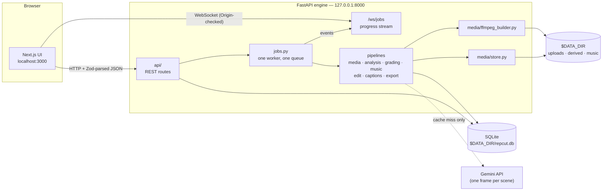

# Architecture

Repcut is two local processes on one machine: a **FastAPI engine** that owns
all media, analysis and rendering, and a **Next.js UI** that drives it. Nothing
runs in the cloud except one narrow call to Gemini for scene understanding.



## Engine (`engine/repcut/`)

### Boundary

| Module | Responsibility |
|---|---|
| `main.py` | App factory, lifespan, readiness checks (`/health`) |
| `security.py` | Host allow-list, CORS, WebSocket `Origin` checks |
| `config.py` | All settings via `pydantic-settings`, read from env / `.env` |
| `api/` | One router per feature; `schemas.py` holds bounded request/response models, `errors.py` the fixed error vocabulary |
| `redaction.py`, `logging.py` | structlog JSON logs with paths and secrets redacted |

### Jobs

`jobs.py` runs **one in-process worker** over an asyncio queue, with one row per
job in the `jobs` table. There is no broker: a queue that survives a restart is
a table, not a service (P5). Step boundaries are persisted; fine-grained FFmpeg
progress goes only to the WebSocket. Progress is clamped so it never moves
backwards, and a failed job reports a cause, never a traceback.

### Pipelines

Each feature package exposes a job handler and a service; routes call the
service, the worker calls the job.

| Package | What it does |
|---|---|
| `media/` | Content-addressed store (`store.py`), probing, ingest to a CFR / bt709 / single-audio-rate **proxy**, derived-artifact recipes and versions |
| `analysis/` | Scene detection, one sampled frame per scene, motion and audio energy, cache-first Gemini tagging with a client-side rate limiter |
| `grading/` | Theme packs (TOML), per-scene measurement and correction, LUT application, graded previews |
| `music/` | Local music library, beat/tempo analysis, track recommendation against the session's energy |
| `edit/` | Per-clip signals (loudness, motion, shake, speech), segment selection, the **pure, seeded cut planner**, override re-sync, voice ducking |
| `captions/` | Local speech-to-text, caption timeline, styles, ASS subtitle generation |
| `export/` | Presets (TOML), reframing crop, segment render + mux to MP4, post-render platform checks |

Cross-cutting modules: `freshness.py` lazily brings derived output up to the
current recipe version; `fingerprints.py` pins each recipe to the version that
keys its output; `probes.py` reports the toolchain and device in `/health`.

### Invariants enforced in code

- **Every FFmpeg call** goes through `media/ffmpeg_builder.py` (`list[str]`
  argv, validated inputs, typed failures). Nothing else spawns FFmpeg.
- **Every filesystem path** comes from `media/store.py`, which refuses anything
  resolving outside `$DATA_DIR`.
- **Derived artifacts are content-addressed**, keyed by
  `(sha256, artifact_kind, params_version)`. A recipe change bumps a version;
  it never mutates an existing file.
- **The planner is pure**: same inputs + same seed = the same edit, byte for
  byte. An override folds into the standing decisions and re-plans from
  scratch (P2), and is logged as a taste event (P3).
- **GPU work** loads one model at a time within a 4 GB budget, with a CPU
  fallback on every path.

### Data

SQLite at `$DATA_DIR/repcut.db`, migrated by Alembic (`engine/alembic/versions/`,
applied with `make migrate`). Core tables: projects, media blobs and files,
derived artifacts, scenes, the Gemini cache, upload sessions, jobs, grade
choices, taste events, music tracks, edit plans, caption and export settings.

## UI (`ui/`)

| Path | Responsibility |
|---|---|
| `app/` | App Router pages: project list, the editor (`projects/[id]`), engine health (`status`), build-progress dashboard (`prompts`, read from the private guide at runtime) |
| `components/` | One folder per feature (upload, analysis, grading, edit, captions, export, jobs, player, …) plus `primitives/`, the in-house design system |
| `lib/api/` | Engine client and **Zod schemas for every response** — the engine is a boundary too |
| `lib/jobs/useJobStream.ts` | WebSocket job progress subscription |
| `app/globals.css`, `tailwind.config.ts` | Design tokens as CSS custom properties — the only source of colour, spacing and type; Tailwind only points at them |
| `next.config.mjs` | Security headers and CSP, including `frame-ancestors 'none'` |

Server Components by default; `"use client"` only where interaction needs it.
Every AI-produced value renders as an editable control with an "AI suggested"
state and a reset action (P2).

## Tooling (`scripts/`)

| Kind | Files |
|---|---|
| Dev environment | `setup.sh`, `check_env.py`, `dev.sh`, `dev_stack.py`, `fetch_models.py` |
| Gates | `verify_NN.sh` + `verify_NN_checks.py`, helpers `gate_human.sh`, `gate_skip.sh`, `gate_conditions.py` |
| Guards | `precommit_guard.sh`, `check_plan_leak.py`, `check_plan_titles.py`, `check_prompts.py` |
| Human review builders | `*_review.py` — build local review pages from real footage (never committed) |
| Test helpers | `gemini_stub.py`, `speech_fixture.py`, `e2e_export.py`, `cdp_browser.py`, `posix_shell.py` |

## Runtime layout on disk

```
$DATA_DIR/                 outside the repo, outside any cloud-sync folder
├── repcut.db              SQLite (WAL)
├── media/                 content-addressed sources and derived artifacts
├── uploads/               resumable upload sessions
├── grading/               measurement / still / preview caches
├── music/                 user-supplied tracks + LICENSES.md
├── models/                downloaded model weights (speech-to-text, VAD)
└── reviews/               locally built human-review pages
```
